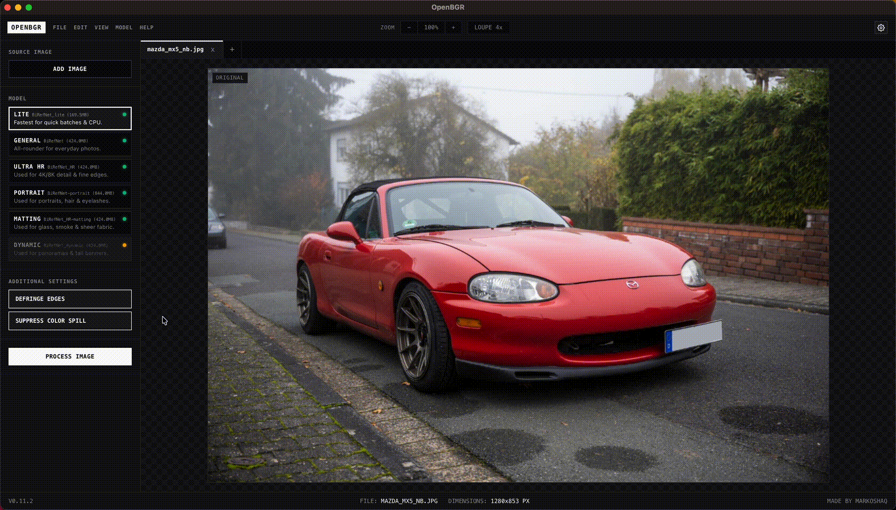

<h1 align="center">OpenBGR</h1>

<p align="center">
  <a href="https://github.com/markoshaq/OpenBGR/actions/workflows/release.yml"></a>
  <a href="https://github.com/markoshaq/OpenBGR/releases"></a>
  <a href="./LICENSE"></a>
</p>

<p align="center">
  Local background removal studio powered by <a href="https://github.com/ZhengPeng7/BiRefNet">BiRefNet</a>.<br>
  Exports full-resolution images in multiple formats with no telemetry, watermarks, or compression.
</p>

<p align="center">
  <br>
  <em>Removing a background using <code>BiRefNet_lite</code> on an 8 GB M1 MacBook Air.</em>
</p>

## Features

- Download models once from Hugging Face, then run **fully offline** from cache.
- Optional **Block Internet Access** mode cuts all Hugging Face traffic; import checkpoints manually to go fully offline ([guide](#install-a-model-without-internet)).
- Switch, reorder, and **merge tabs into batches** with familiar browser hotkeys; zoom, pan, and export settings are per-tab.
- **Batch-process** any number of images under one settings snapshot; export to a folder or a single ZIP.
- Pick a model **per machine and image**: weak hardware, everyday photos, 4K detail, portraits, glass and smoke, odd aspect ratios ([model table](#models)).
- Zoom, pan, and inspect edges with gestures, view hotkeys, and a **4x loupe**.
- **Preview exports live** at any scale, exact pixel size, or aspect preset, with Fit / Stretch canvas fill and a byte-exact size readout.
- **Auto-crop to the subject** with adjustable padding and a live crop guide.
- Pick a backdrop: transparency grid, flat color, the original photo **blurred** behind the cutout, or a second photo.
- Defringe, suppress color spill, **shift and feather the matte edge**, and cut shadow/reflection alpha, all **in real time** with no re-inference.
- Run it as a **desktop app** with native menus and themes, or fall back to a plain browser tab.
- **Right-click** to install or uninstall models, with live progress and per-model disk usage. GPU-accelerated on NVIDIA and Apple Silicon.

## Installation

### From a release

Download from [Releases](https://github.com/markoshaq/OpenBGR/releases):

- **Windows:** `OpenBGR-Setup.exe` (installer) or `OpenBGR-Windows.zip` (portable)
- **macOS:** `OpenBGR-macOS.dmg`
- **Linux:** `OpenBGR-Linux.tar.gz`, extract and run `./start.sh`

> The macOS build is ad-hoc signed. Right-click OpenBGR.app > Open if Gatekeeper prompts.

An internet connection is needed once: the first launch downloads a Python runtime and the model you pick. Requires macOS 11+, Windows 10+, or a modern Linux desktop; 8 GB RAM recommended; GPU optional.

### From source

```bash
git clone https://github.com/markoshaq/OpenBGR.git
cd OpenBGR
./start.sh   # or start.bat on Windows; provisions Python via uv if needed
```

The app opens at `http://127.0.0.1:7860`. For headless and right-click usage, see the next section.

## Right-Click / "Open With" Integration

Wire OpenBGR into your file manager from **Preferences > Quick Action > Right-Click Context Menu**, or run a script:

- **Windows:** on by default in `OpenBGR-Setup.exe`; portable ZIP users run `scripts\install_windows_context_menu.bat`.
- **macOS:** *Open With* and Dock drops work out of the box; the Finder Quick Action installs from Preferences or `python3 scripts/install_macos_quick_action.py`.
- **Linux:** `./scripts/install_linux_integration.sh` installs `.desktop` and file-manager entries.

Model, format, destination, and notifications are configurable in Preferences; cutouts land next to the original as `<name>-cutout.png`.

Or run it directly, no window:

```bash
python app.py --cli photo.png                  # writes photo-cutout.png
python app.py --cli a.png b.png -o ~/cutouts   # batch to a directory
python app.py --cli photo.png --tier portrait  # pick a model preset
python app.py --quick-action photo.png         # run with saved Quick Action prefs
python app.py photo.png                        # open app (or tab in running window)
```

> Right-clicking while the app is running reuses the warm instance over localhost: near-instant cutouts, opened files appear as new tabs. A standalone run cold-starts in ~10-20 s.

## Models

| Model | Runs at | Size | Best for |
| :--- | :--- | :--- | :--- |
| **Lite** (`lite`) | 1K | ~85 MB | Weak hardware, quick batches |
| **General** (`general`, default) | 1K | ~424 MB | Everyday photos, products, animals |
| **Ultra HR** (`hr`) | up to 2K | ~424 MB | 4K/8K shots, micro-edge detail |
| **Portrait** (`portrait`) | 1K | ~425 MB | People, headshots, hair |
| **Matting** (`matting`) | up to 2K | ~424 MB | Glass, smoke, sheer fabric |
| **Dynamic** (`dynamic`) | up to 2K, native ratio | ~424 MB | Panoramas, tall banners |

Each model downloads to the Hugging Face cache on first use only; FP32 checkpoints auto-compact to FP16 on disk. Masks always upscale back to the source's exact resolution, and 2K models run at 1.5K on machines under ~14 GB of memory.

### Install a model without internet

1. Download a model folder, e.g. `hf download ZhengPeng7/BiRefNet` or the repo from huggingface.co, and copy it to the machine.
2. In OpenBGR, open **Settings > Models > IMPORT MODEL FOLDER**, pick the model, choose the folder.
3. Optionally enable **Settings > Block Internet Access** (or launch with `OPENBGR_OFFLINE=1`).

## API

The local FastAPI server that drives the UI is callable directly, so scripts and other apps can use the same pipeline. Mutating calls require the per-session token the server writes to `~/.openbgr/session_token` at launch:

```bash
curl -X POST "http://127.0.0.1:7860/api/remove-bg" \
  -H "x-openbgr-token: $(cat ~/.openbgr/session_token)" \
  -F "file=@photo.jpg" \
  -F "tier=general" \
  -F "defringe=true" \
  -o photo-cutout.png
```

| Endpoint | Purpose |
| :--- | :--- |
| `POST /api/remove-bg` | Run a cutout (the call above) |
| `POST /api/refine` | Re-apply edge filters and shift/feather geometry to the cached job, no re-inference |
| `GET /api/status` | Version, device, RAM, per-model cache state |
| `GET /api/progress` | Pipeline phase + live download bytes |
| `POST /api/cancel` | Abort the active job |
| `POST /api/save` | Write the result to a chosen folder |
| `POST /api/models/install` `/uninstall` | Manage checkpoints |
| `POST /api/open-files` `/pending-files` | Queue/drain OS "Open With" paths |
| `POST /api/open-cache-dir` `/open-logs-dir` | Reveal the HF cache or logs folder |
| `GET/POST /api/quick-action*` | Quick Action config, run, and OS integration |

## Troubleshooting

- **"OpenBGR is damaged" or Gatekeeper refusal (macOS).** Ad-hoc signed, not notarized. Right-click `OpenBGR.app` > **Open** once, or run `xattr -cr /Applications/OpenBGR.app`.
- **"Address already in use" on launch.** Port 7860 is taken by another app. Close it or launch with `PORT=7861 ./start.sh`.
- **Model download stalls.** First run pulls PyTorch (~2 GB) plus a model (~85-425 MB). Downloads resume on retry; if Hugging Face is unreachable, set `HF_ENDPOINT` to a mirror.
- **GPU not detected.** Apple Silicon uses MPS automatically; on NVIDIA, the launcher installs CUDA wheels when `nvidia-smi` is present. Otherwise it runs on CPU.
- **Quick Action does nothing.** Check `~/.openbgr/openbgr.log` (**Preferences > About > Open Logs Folder**), or run `context_process.sh` on a file to see the error. Cold start is ~10-20 s.

## Contributing

Contributions are welcome. See [CONTRIBUTING.md](./CONTRIBUTING.md) for dev setup, checks, project layout, and the release process.

## Acknowledgements

Thanks to Zheng Peng and contributors for [BiRefNet](https://github.com/ZhengPeng7/BiRefNet), the segmentation model family behind every cutout in OpenBGR.

## License

[MIT](./LICENSE)
