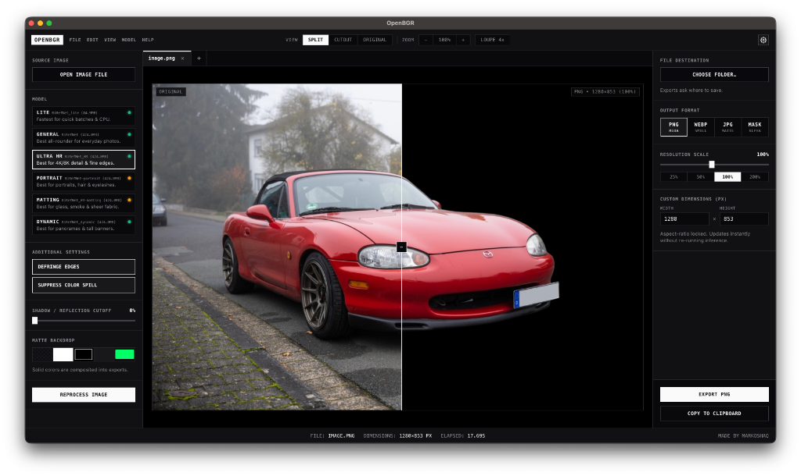

# OpenBGR

[](https://github.com/markoshaq/OpenBGR/actions/workflows/release.yml)
[](https://github.com/markoshaq/OpenBGR/releases)
[](./LICENSE)

Multi-tab background removal studio powered by [BiRefNet](https://github.com/ZhengPeng7/BiRefNet), running entirely on your machine. FastAPI backend, pywebview desktop shell, vanilla ES-module frontend with no build step. Exports full-resolution images in multiple formats with no telemetry, watermarks, or compression.



## Features

- **100% offline after setup.** Weights download once from Hugging Face, then run strictly from local cache. No uploads, telemetry, accounts, or subscriptions.
- **Multi-tab workspace.** `⌘1`-`⌘9` / `Ctrl+1`-`Ctrl+9` or `⌃Tab` / `Ctrl+Tab` to switch, drag tabs together to merge them into a batch, per-tab zoom/pan/export settings.
- **Batch processing.** Queue any number of images under one settings snapshot, with per-file status and recovery, drag-out extraction, and folder or single-ZIP export.
- **Six specialized models.** From a fast `Lite` build for CPUs to 2K soft-alpha `Matting`. See the [model table](#models).
- **Zoom, pan & 4x loupe.** Pinch, two-finger, and `Space + Drag` navigation (`100%-800%`), view hotkeys (`1`/`2`/`3`), and a `Z`-key magnifier for hair and edges.
- **Live export preview.** `PNG`, `WEBP`, `JPG`, or alpha `MASK` at any scale or exact pixel size, with aspect lock, matte backdrop compositing, and a real-time file-size readout, all without re-running inference.
- **Instant edge refinement.** Defringe, color-spill suppression, and a shadow/reflection alpha cutoff, re-applied in ~20 ms without re-running the model.
- **Native desktop window.** `pywebview` app window with native menus, themes, clipboard paste, Save-As/folder dialogs, shortcuts pane, window-state restore, and browser fallback.
- **Model management.** Right-click a model card to install/uninstall with live download progress, open the HF cache or logs folder, and see disk usage per model. `FP16` inference on CUDA and Apple MPS.

## Installation

### From a release

Download the latest build for your OS from [Releases](https://github.com/markoshaq/OpenBGR/releases):

- **macOS.** Open `OpenBGR-macOS.dmg` and drag `OpenBGR.app` into Applications. The build is ad-hoc signed rather than Apple-notarized, so Gatekeeper may prompt on first launch; right-click `OpenBGR.app` > **Open** once, or run `xattr -cr /Applications/OpenBGR.app`.
- **Windows.** Run `OpenBGR-Setup.exe` (installs per-user under `%LOCALAPPDATA%\OpenBGR` with Start Menu, uninstaller, and optional Explorer context-menu shortcuts), or extract `OpenBGR-Windows.zip` and run `OpenBGR.exe` / `start.bat` for a portable folder.
- **Linux.** Extract `OpenBGR-Linux.tar.gz` and run `./start.sh` inside the extracted folder.

On first run the launcher sets up a standalone Python runtime (auto-selecting CUDA PyTorch on NVIDIA GPUs) and downloads the model you pick, so an internet connection is needed once.

### Requirements

- **OS:** macOS 11+, Windows 10+, or a modern Linux desktop (Wayland or X11).
- **RAM:** 8 GB recommended for `General` and the 2K models; the `Lite` model runs comfortably on 4 GB.
- **Disk:** ~2-3 GB for the provisioned Python runtime and PyTorch, plus ~170-845 MB per model you download (FP32 checkpoints are compacted to FP16 on disk, ~85-425 MB installed).
- **GPU:** optional. CUDA and Apple MPS get `FP16` inference; everything also works on CPU.
- No Python install needed: release builds bundle a runtime, and the source launcher auto-provisions one via `uv` if none is found.

### From source

Works on macOS, Windows, and Linux. If Python 3.10+ isn't installed on your machine, the launch script automatically provisions a standalone Python 3.12 runtime via [`uv`](https://docs.astral.sh/uv/).

**macOS & Linux**
```bash
git clone https://github.com/markoshaq/OpenBGR.git
cd OpenBGR
./start.sh
```

**Windows**
```bat
git clone https://github.com/markoshaq/OpenBGR.git
cd OpenBGR
start.bat
```

Or download the repository ZIP and double-click `Start Mac.command` (macOS) or `start.bat` (Windows). The app opens at `http://127.0.0.1:7860`.

### Headless / CLI-only install (Quick Action without the GUI)

For scripts, servers, or machines that should never open a window. Same local pipeline, same privacy guarantees:

```bash
git clone https://github.com/markoshaq/OpenBGR.git && cd OpenBGR
./start.sh --cli photo.png      # one-time setup: provisions .venv + model, writes photo-cutout.png
python3 scripts/install_macos_quick_action.py   # registers the right-click entry
```

On Windows use `start.bat` and `scripts\install_windows_context_menu.bat`; on Linux `./scripts/install_linux_integration.sh`.

`start.sh --cli` provisions the environment itself, so this works on a fresh clone. Afterwards use `python app.py --cli` or `--quick-action` from your own scripts: `--quick-action` applies the saved Quick Action preferences (model, format, destination, clipboard, notification), while `--cli` takes explicit flags. It still needs the same torch + model download (~1.5 GB); the difference is that no window, browser, or server is ever opened.

## Right-Click / "Open With" Integration

OpenBGR can be wired into your OS file manager from **Preferences > Quick Action > Right-Click Context Menu** (one-click **Install** / **Uninstall**), or via the helper scripts below. You can customize the Quick Action model preset, save destination (same folder or Save dialog), output format (`PNG`, `WEBP`, `JPG`, `MASK`), edge refinement, clipboard copy, and completion notifications in Preferences. Everything stays 100% local: by default the cutout is written next to the original as `<name>-cutout.png` and nothing is uploaded.

**macOS.** Finder Quick Action (right-click > Quick Actions > *Remove Background with OpenBGR*):

```bash
python3 scripts/install_macos_quick_action.py     # --remove to uninstall
```

The release `OpenBGR.app` also registers itself as an "Open With" target for image files: right-click > Open With > OpenBGR launches the app with the image loaded in a tab. (Dragging onto the Dock icon works too.)

**Windows.** Explorer context menu (per-user registry entries, no admin):

```bat
scripts\install_windows_context_menu.bat           :: uninstall: scripts\uninstall_windows_context_menu.bat
```

Adds *Remove Background with OpenBGR* (headless cutout) and *Open in OpenBGR*.

**Linux.**

```bash
./scripts/install_linux_integration.sh            # --remove to uninstall
```

Installs an "Open With" `.desktop` entry with the OpenBGR icon, a KDE Dolphin service-menu action, and a GNOME Files (Nautilus) script (`zenity` and `kdialog` are both supported for interactive save/folder dialogs).

**CLI.** The same pipeline is available directly:

```bash
python app.py --cli photo.png                      # writes photo-cutout.png
python app.py --cli a.png b.png -o ~/cutouts       # batch to a directory
python app.py --cli photo.png -o                   # native Save-As dialog
python app.py --cli photo.png --tier portrait      # pick a model preset
python app.py --cli photo.png --format webp        # png, webp, jpg, or mask
python app.py --quick-action photo.png             # run with saved Quick Action prefs
python app.py photo.png                            # open app (or tab in running window)
```

When an OpenBGR window is already running, both the right-click Quick Action and "Open in OpenBGR" reuse the running instance over localhost across macOS, Windows, and Linux (the model is warm, so cutouts are near-instant and opened files appear as new tabs); otherwise `app.py` runs standalone (~10-20 s cold start while PyTorch and the model load).

## Models

| Model | Checkpoint | Backbone | Native Resolution | FP16 Size | Best For |
| :--- | :--- | :--- | :--- | :--- | :--- |
| **Lite** (`lite`) | `ZhengPeng7/BiRefNet_lite` | Swin-T | `1024 x 1024` | ~85 MB | Quick batches, CPUs & integrated graphics |
| **General** (`general`, *Default*) | `ZhengPeng7/BiRefNet` | Swin-L | `1024 x 1024` | ~424 MB | Products, objects, animals & everyday photos |
| **Ultra HR** (`hr`) | `ZhengPeng7/BiRefNet_HR` | Swin-L | `1536` / `2048` | ~424 MB | 4K/8K studio photos & micro-edge detail |
| **Portrait** (`portrait`) | `ZhengPeng7/BiRefNet-portrait` | Swin-L | `1024 x 1024` | ~425 MB (845 MB download) | People, headshots, flyaway hair & eyelashes |
| **Matting** (`matting`) | `ZhengPeng7/BiRefNet_HR-matting` | Swin-L | `1536` / `2048` | ~424 MB | Glass, smoke, veils, sheer fabric & soft alpha |
| **Dynamic** (`dynamic`) | `ZhengPeng7/BiRefNet_dynamic` | Swin-L | Up to `2048` (native ratio) | ~424 MB | Ultrawide panoramas & tall vertical banners |

Output masks are always upsampled (`LANCZOS`) back to the exact pixel dimensions of the source image. Any FP32 checkpoint downloaded from Hugging Face is automatically compacted to FP16 on disk.

Weights download on first use of each model into the standard Hugging Face cache (`~/.cache/huggingface`), only for the models you actually run.

## API

You can also call the FastAPI server directly:

```bash
curl -X POST "http://127.0.0.1:7860/api/remove-bg" \
  -F "file=@photo.jpg" \
  -F "tier=general" \
  -F "defringe=true" \
  -o photo-cutout.png
```

Other endpoints: `GET /api/status` (version, device, RAM, per-model cache state), `POST /api/refine` (re-apply edge filters to the cached job without re-inference), `POST /api/models/install` / `/api/models/uninstall` (checkpoint management), `POST /api/save` (write to a chosen folder), `POST /api/open-cache-dir` / `POST /api/open-logs-dir` (reveal the HF cache or `~/.openbgr` logs folder in the OS file manager), `GET /api/progress` (pipeline phase + live model-download byte counts), `POST /api/cancel` (abort the active job), `POST /api/open-files` / `POST /api/pending-files` (queue and drain OS "Open With" image paths), and `GET/POST /api/quick-action-config`, `POST /api/quick-action`, `POST /api/quick-action-install` (Quick Action settings, execution, and OS integration).

## Tests

```bash
python -m unittest discover -s tests -v   # backend suite
node --test "tests/*.test.mjs"            # frontend unit tests (needs Node 18+)
```

Backend tests are split by concern across `tests/test_*.py`; frontend helpers are covered by `tests/*.test.mjs`. The suite exercises the status contract, refine endpoint, save sanitization, FP16 compaction, the edge-refinement pipeline, end-to-end segmentation with a mocked model, CLI & Quick Action runners, the desktop bridge, frontend DOM/module integrity and state helpers, icon geometry, and release-archive contents. CI runs the same suite on CPU-only PyTorch for every push and pull request (`.github/workflows/release.yml`).

## Development

The project ships a `pyproject.toml` configured for [Ruff](https://docs.astral.sh/ruff/) and [mypy](https://mypy.readthedocs.io/), plus a dev-only `package.json` with [ESLint](https://eslint.org/) for the `static/` ES modules. See [CONTRIBUTING.md](./CONTRIBUTING.md) for the full setup:

```bash
pip install -e ".[dev]"
ruff check . && ruff format --check .   # lint
mypy app.py openbgr scripts             # type-check
npm ci && npx eslint static             # frontend lint (Node 18+)
```

## Project Layout

```text
├── app.py                  # Entrypoint (CLI / Quick Action / desktop launcher)
├── openbgr/
│   ├── config.py           # Runtime paths, hardware auto-detection & model tier registry
│   ├── models.py           # Thread-safe ModelManager, HF cache inspection & FP16 compaction
│   ├── pipeline.py         # Defringe, color-spill suppression, RGBA composition & segmentation
│   ├── icon_render.py      # Shared macOS squircle icon renderer (Pillow-only)
│   ├── quick_action.py     # Quick Action / headless CLI runner & cutout encoding
│   ├── quick_action_config.py # Persisted Quick Action settings & OS integration install
│   ├── quick_action_native.py # Native clipboard, dialogs & notification dispatch
│   ├── desktop_bridge.py   # JS↔Python bridge (DesktopApi) & pending open-files queue
│   ├── desktop_window.py   # Window geometry persistence & chromeless browser fallback
│   ├── desktop_menus.py    # Native menu bar (macOS / Linux GTK)
│   ├── desktop_cocoa.py    # macOS-only: app name, NSMenu/appearance & 'odoc' handlers
│   ├── server_probe.py     # Local-server probes & single-instance file forwarding
│   └── api.py              # FastAPI application and HTTP endpoints
├── pyproject.toml          # Project metadata, ruff & mypy configuration
├── docs/
│   └── screenshot.png      # README hero image
├── static/
│   ├── index.html          # 3-column studio workspace
│   ├── styles.css          # Stylesheet
│   ├── state.js            # Shared state, tab model & helpers
│   ├── stage.js            # Split view, pan/zoom & loupe rendering
│   ├── export.js           # Canvas export pipeline & ZIP writer
│   ├── preferences.js      # Hardware status, cache dots & preferences
│   ├── batch.js            # Batch queue, panel & runner
│   ├── tabs.js             # Tab bar, ingestion & segmentation lifecycle
│   └── app.js              # Event wiring, menus & native bridge
├── scripts/
│   ├── build_release.py    # Builds .dmg / OpenBGR-Setup.exe / .zip / .tar.gz into dist/
│   ├── OpenBGR.iss         # Thin Inno Setup 6 definition for OpenBGR-Setup.exe
│   ├── OpenBGR.cs          # C# first-run bootstrapper compiled into OpenBGR.exe
│   ├── make_dev_bundle.py  # Generates the venv-local OpenBGR.app for dev runs
│   ├── context_process.sh  # Headless cutout helper (server fast-path > --cli fallback)
│   ├── install_macos_quick_action.py      # Finder "Remove Background" Quick Action
│   ├── install_windows_context_menu.bat   # Explorer right-click entries (HKCU)
│   ├── uninstall_windows_context_menu.bat
│   └── install_linux_integration.sh       # .desktop / KDE / Nautilus entries
├── tests/
│   ├── test_api.py             # HTTP endpoint contracts & pending-file queueing
│   ├── test_pipeline.py        # Icon render, edge refinement, FP16 compaction, segmentation
│   ├── test_quick_action.py    # Quick Action config, dialogs, runner & notifier bundle
│   ├── test_repo_integrity.py  # Version/dependency sync, release payloads & DOM integrity
│   └── state.test.mjs          # Frontend state helpers (node:test)
├── Start Mac.command       # macOS Finder launcher
├── start.sh                # macOS / Linux bootstrapper
├── start.bat               # Windows bootstrapper
└── requirements.txt        # Python dependencies
```

## Building Desktop Releases (`.dmg` / `.exe` / Linux)

To build desktop release bundles locally into `dist/`:

```bash
python3 scripts/build_release.py
```

Pushing a version tag (e.g. `git tag v0.11.1 && git push origin v0.11.1`) triggers `.github/workflows/release.yml` to build and attach `OpenBGR-macOS.dmg`, `OpenBGR-Setup.exe`, `OpenBGR-Windows.zip`, `OpenBGR-Linux.tar.gz`, and `SHA256SUMS.txt` to a GitHub Release automatically.

## Troubleshooting

- **"OpenBGR is damaged" or Gatekeeper refusal on macOS.** The release is ad-hoc signed, not notarized. Right-click `OpenBGR.app` > **Open** once, or run `xattr -cr /Applications/OpenBGR.app`.
- **"Address already in use" on launch.** Another non-OpenBGR application is already using port 7860. Close it, or start on a different port with `PORT=7861 ./start.sh`.
- **First launch is slow or a model download stalls.** The first run downloads PyTorch (~2 GB) plus the model (~85-425 MB). Downloads resume automatically on retry; if Hugging Face is unreachable, set `HF_ENDPOINT` to a mirror or check your proxy/firewall.
- **Wrong GPU or CUDA not detected.** On Apple Silicon the app uses MPS automatically; CPU fallback is only expected on machines without a supported GPU. On Windows/Linux with NVIDIA, install a CUDA build of PyTorch into `.venv`; the launcher picks CUDA wheels automatically when `nvidia-smi` is present.
- **Quick Action does nothing on right-click.** Check that the installer ran without errors, then inspect `~/.openbgr/openbgr.log` (via **Preferences > System > Open Logs Folder**) or run `context_process.sh` manually on a file to see the real error. The app does not need to be running; it cold-starts in ~10-20 s.

## License

[MIT](./LICENSE)
